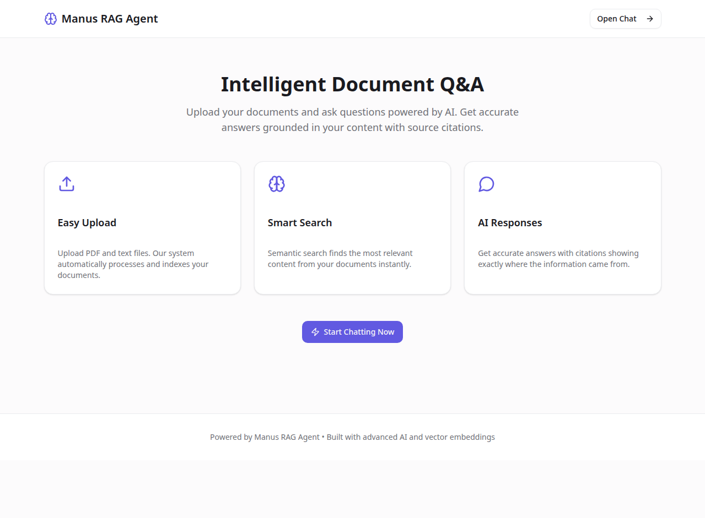
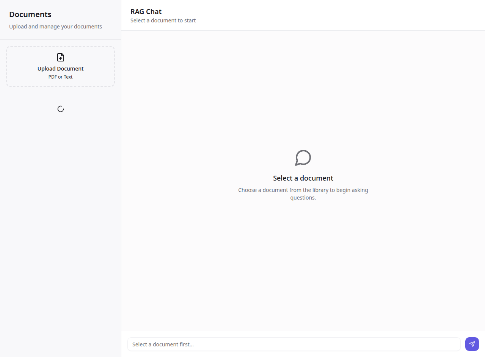

# 🧠RAG Agent

A sophisticated **Retrieval-Augmented Generation (RAG)** application that enables intelligent document Q&A powered by AI. Upload your documents, ask questions, and get accurate answers grounded in your content with source citations.



## ✨ Features

### 📤 Document Management
- **Easy Upload** — Support for PDF and text files with automatic processing
- **Smart Indexing** — Documents are automatically chunked and indexed with vector embeddings
- **Document Library** — Manage all your uploaded documents in one place
- **One-Click Delete** — Remove documents and their associated data instantly

### 🔍 Intelligent Search
- **Semantic Search** — Uses vector embeddings to find relevant content based on meaning, not just keywords
- **Cosine Similarity** — Advanced similarity matching for precise document retrieval
- **Context Awareness** — Retrieves the most relevant chunks from your documents

### 🤖 AI-Powered Responses
- **LLM Integration** — Powered by state-of-the-art language models
- **Source Citations** — Every answer includes references showing which documents were used
- **Similarity Scores** — See how relevant each source is to your query
- **Markdown Support** — Responses are formatted with full markdown rendering

### 💬 Chat Experience
- **Conversation History** — All chats are persisted and retrievable
- **Per-Document Chats** — Have separate conversations for each document
- **Real-Time Feedback** — Loading states and user-friendly error messages
- **Elegant UI** — Refined, polished interface with smooth interactions



## 🚀 Quick Start

### Prerequisites
- Node.js 22+
- pnpm (or npm/yarn)
- MySQL database
- Manus API credentials (for LLM and storage)

### Installation

```bash
# Clone the repository
git clone https://github.com/USERASHOKG/rag-agent.git
cd rag-agent

# Install dependencies
pnpm install

# Set up environment variables
cp .env.example .env.local
# Edit .env.local with your credentials

# Run database migrations
pnpm run db:push

# Start the development server
pnpm run dev
```

The application will be available at `http://localhost:3000`

## 🏗️ Architecture

### Tech Stack

**Frontend:**
- React 19 with TypeScript
- Tailwind CSS 4 for styling
- shadcn/ui component library
- Wouter for routing
- tRPC for type-safe API calls

**Backend:**
- Express.js server
- tRPC for RPC procedures
- Drizzle ORM for database management
- MySQL/TiDB database
- Manus OAuth for authentication

**AI & Storage:**
- Built-in LLM API for embeddings and responses
- S3 storage for document files
- Vector embeddings for semantic search

### Database Schema

```
Documents
├── id (PK)
├── userId (FK)
├── fileName
├── fileKey (S3 reference)
├── fileUrl
├── fileSize
├── mimeType
├── totalChunks
└── timestamps

Chunks
├── id (PK)
├── documentId (FK)
├── chunkIndex
├── text
├── embeddingId (FK)
└── timestamps

Embeddings
├── id (PK)
├── chunkId (FK)
├── vector (JSON array)
├── model
└── timestamps

Messages
├── id (PK)
├── userId (FK)
├── documentId (FK, nullable)
├── role (user|assistant|system)
├── content
├── sourceChunkIds (JSON)
└── timestamps
```

## 🔄 How It Works

### 1. Document Upload
When you upload a document:
1. File is stored in S3 storage
2. Text is extracted from PDF or read from text files
3. Content is split into semantic chunks (1000 chars with overlap)
4. Each chunk is embedded using the LLM embedding model
5. Embeddings and metadata are stored in the database

### 2. Query Processing
When you ask a question:
1. Your query is converted to an embedding
2. Cosine similarity search finds the top 5 most relevant chunks
3. Retrieved chunks are formatted as context
4. LLM generates a response using the context
5. Response and source references are saved to chat history

### 3. Response Generation
The LLM receives:
- System prompt instructing it to cite sources
- User query
- Retrieved document excerpts as context
- Returns a grounded, cited response

## 📝 API Endpoints

### tRPC Procedures

**Documents:**
- `rag.uploadDocument` — Upload and process a document
- `rag.listDocuments` — Get all user's documents
- `rag.getDocument` — Get document details
- `rag.deleteDocument` — Delete a document

**Chat:**
- `rag.queryRAG` — Query documents and get AI response
- `rag.getChatHistory` — Retrieve conversation history

**Auth:**
- `auth.me` — Get current user info
- `auth.logout` — Sign out

## 🎨 Design System

### Color Palette
- **Primary:** Elegant indigo/purple (`oklch(0.55 0.2 280)`)
- **Background:** Clean white/dark (`oklch(0.99 0.001 0)` / `oklch(0.12 0.005 280)`)
- **Accent:** Refined accent colors with high contrast
- **Destructive:** Red for critical actions

### Typography
- Clean, modern sans-serif fonts
- Consistent spacing and sizing
- Accessible color contrasts

### Components
- Shadcn/ui for consistent, accessible components
- Tailwind CSS for utility-first styling
- Lucide React for beautiful icons

## 🔐 Security

- **OAuth Authentication** — Secure Manus OAuth integration
- **Private Repository** — Source code is protected
- **Environment Variables** — Sensitive data in `.env.local`
- **Database Security** — Indexed queries and proper relationships
- **File Storage** — S3 with signed URLs

## 📊 Performance

- **Vector Embeddings** — Fast semantic search with cosine similarity
- **Database Indexing** — Optimized queries on userId, documentId, chunkId
- **Chunking Strategy** — Semantic chunks with overlap for better context
- **Caching** — tRPC query caching for repeated requests

## 🛠️ Development

### Project Structure

```
rag-agent/
├── client/                 # React frontend
│   ├── src/
│   │   ├── pages/         # Page components
│   │   ├── components/    # Reusable UI components
│   │   ├── lib/           # Utilities and helpers
│   │   └── App.tsx        # Main app component
│   └── index.html
├── server/                # Express backend
│   ├── ragRouter.ts       # RAG procedures
│   ├── documentProcessor.ts # Text processing
│   ├── db.ts              # Database queries
│   └── _core/             # Framework code
├── drizzle/               # Database schema
│   ├── schema.ts          # Table definitions
│   └── migrations/        # SQL migrations
├── shared/                # Shared types
└── package.json
```

### Running Tests

```bash
# Run unit tests
pnpm test

# Run type checking
pnpm check

# Format code
pnpm format
```

### Building for Production

```bash
# Build the project
pnpm build

# Start production server
pnpm start
```

## 🚀 Deployment

The application is ready to deploy on any Node.js hosting platform:

- **Manus Platform** — Built-in deployment with auto-scaling
- **Vercel** — Serverless deployment
- **Railway** — Container-based deployment
- **Heroku** — Traditional hosting
- **Self-hosted** — Docker or direct Node.js

### Environment Variables Required

```
DATABASE_URL=mysql://...
JWT_SECRET=your-secret-key
VITE_APP_ID=your-app-id
OAUTH_SERVER_URL=https://api.manus.im
BUILT_IN_FORGE_API_URL=https://api.manus.im/forge
BUILT_IN_FORGE_API_KEY=your-api-key
VITE_FRONTEND_FORGE_API_KEY=your-frontend-key
VITE_FRONTEND_FORGE_API_URL=https://api.manus.im/forge
```

## 🤝 Contributing

Contributions are welcome! Please feel free to submit a Pull Request.

## 📄 License

This project is open source and available under the MIT License.

## 🙋 Support

For issues, questions, or suggestions, please open an issue on GitHub.

---

Powered by advanced AI and vector embeddings for intelligent document Q&A.
